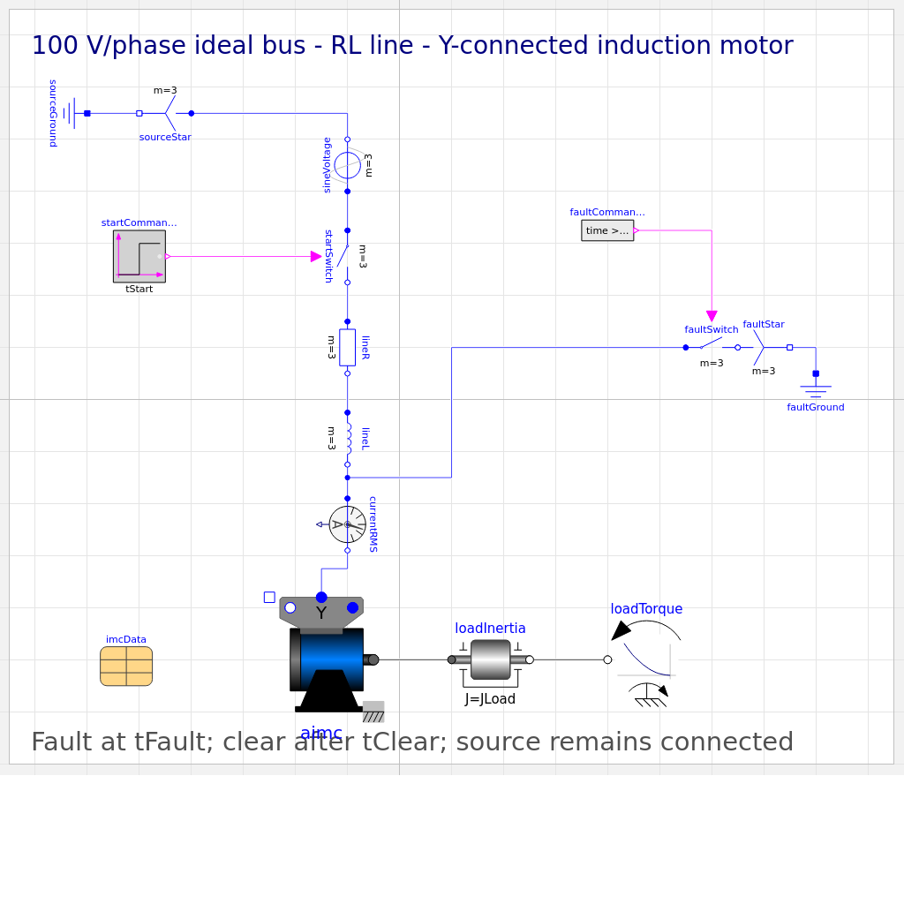
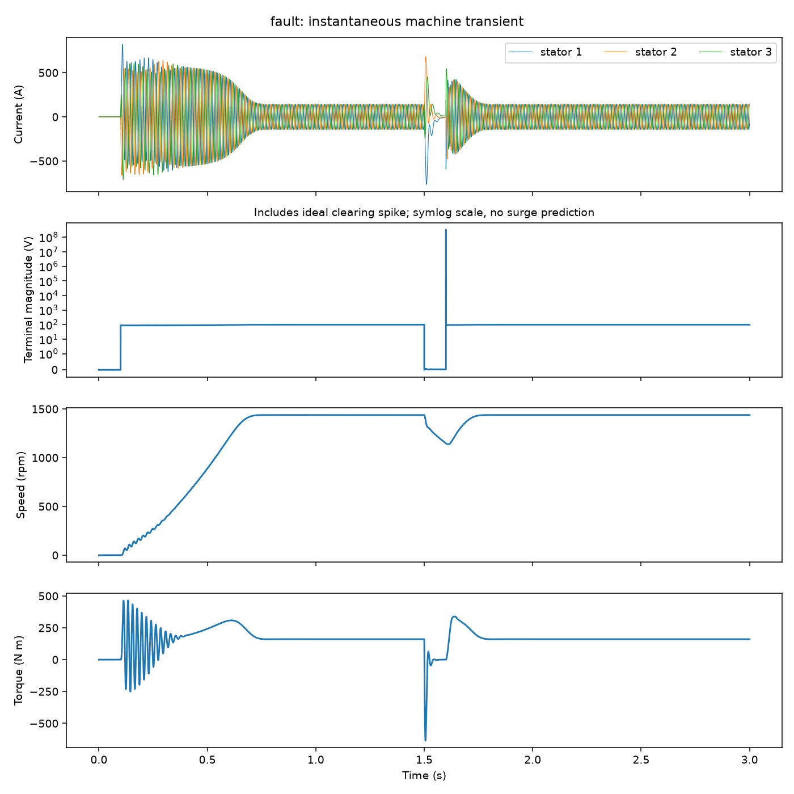
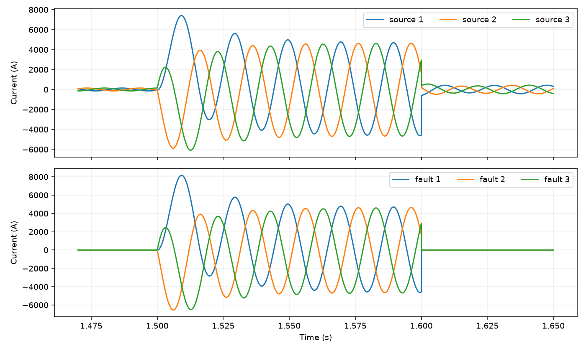

# OpenModelica EMT Base Models — Induction Machine + Line + Bolted Fault

Ready-to-edit electromagnetic-transient (EMT) starter models for [OpenModelica](https://openmodelica.org/): a three-phase squirrel-cage induction motor started direct-on-line from an ideal source through a short RL line, plus the same setup with a bolted three-phase terminal fault and clearing event.

Every knob you would normally dig through nested library models to reach is a **top-level parameter**: voltage, frequency, contactor time, load torque, load inertia, line R/L, fault onset and clearing duration, and the full machine data record. Open the file, change a number, hit Simulate.

The models are instantaneous-value (phase-domain stator, dq rotor): they resolve winding and switching behavior on microsecond–millisecond timescales — DC offset at switching, 50 Hz torque pulsation — inside a 3-second run that also shows the slower electromechanical speed envelope. They are built entirely from public Modelica Standard Library 4.1.0 components with the default demo machine data, and they were verified against independent hand calculations before release (numbers below).



## Why this exists

Setting up a first machine-transient model from stock library examples usually means untangling inherited templates, hidden modifiers and package hierarchies. This repository is the opposite: two small, self-contained, heavily documented models whose structure you can read in one screen and whose parameters you can change without fighting the example. Use them as the **base model** for your own EMT studies: add your machine data, your line, your fault location.

This is not PSCAD/EMTP/ETAP and not a plant twin: no travelling-wave or frequency-dependent lines, no arc model, no converter switching, no protection, no magnetic saturation (see [Limitations](#limitations)).

## Repository layout

```
Models/
  EmtMachineBase.mo        # induction machine + ideal source + RL line, DOL start
  EmtMachineBaseFault.mo   # same + bolted 3-phase terminal fault at tFault, cleared after tClear
Scripts/
  check_and_simulate.mos   # compiler-only batch verification (omc)
  check_and_simulate.py    # same via OMPython, with full CSV validation
Fixtures/
  BrokenMissingClass.mo    # deliberate misspelled-class copy; the checks must fail on it
Results/                   # empty; batch scripts write CSVs here
docs/
  VERIFICATION.md          # what was checked, with numbers
  images/                  # diagrams and result plots
```

Each `.mo` is one independent top-level model depending only on MSL 4.1.0 — no package hierarchy, no relative resources. `.mos` files are batch text for `omc`; **opening a `.mos` in OMEdit does not execute it**.

## Requirements

| Software | Version verified | Notes |
|---|---|---|
| OpenModelica (OMEdit + `omc`) | **1.27.1** | Any 1.24+ should work; 1.27.1 is what was verified. Installers: https://openmodelica.org/download/ |
| Modelica Standard Library | **4.1.0** | Ships inside OpenModelica ≥ 1.24 — nothing separate to download. The models declare `uses(Modelica(version="4.1.0"))` so it auto-loads. If OMEdit cannot find it: File → Manage Libraries → Install Library → `Modelica` 4.1.0 (or `installPackage(Modelica, "4.1.0", exactMatch=true)`). |
| C compiler + CMake | bundled | Simulation compiles generated C. The Ubuntu/Debian `openmodelica` apt packages pull in clang and CMake automatically; the Windows installer bundles everything. |
| Python 3.10+ with `OMPython` 4.1.0 | optional | Only for `Scripts/check_and_simulate.py`. Not needed for OMEdit or the `.mos` script. |

## Quick start (OMEdit)

1. Clone or download this repository somewhere writable (do **not** put it inside the OpenModelica installation folder — OMEdit treats those as read-only system libraries).
2. OMEdit → File → Open Model/Library File(s) → `Models/EmtMachineBaseFault.mo` (or `EmtMachineBase.mo`).
3. Double-click the model in the Libraries browser to see the diagram: grounded source → DOL contactor (`tStart`) → line R/L → RMS ammeter → terminal box → motor → inertia → quadratic load; the fault model adds `faultCommand` → `faultSwitch` → `faultStar` → ground on the right.
4. Simulate (experiment annotation: 3 s, 0.1 ms output, tolerance 1e-6; ~10–15 s wall time). One notice about a *redundant initial equation* is expected and documented — it is not an error.
5. Switch to Plotting and tick variables in the Variables browser. Suggested first plots:
   - `aimc.wMechanical` — shaft speed (rev/min)
   - `currentRMS.I` — stator quasi-RMS current (A)
   - `iSource[1]`, `iSource[2]`, `iSource[3]` — source phase currents (A)
   - `aimc.tauElectrical` — electromagnetic torque (N·m)
   - `vTerminal[1:3]`, `terminalVRMS` — terminal voltages (V)

### Parameters to change first

| Parameter | Default | Unit | Try |
|---|---|---:|---|
| `tClear` (fault model) | 0.1 | s | 0.2 → deeper speed dip (~1000 rpm), clearing at `tFault + tClear` |
| `TLoad` | 161.4 | N·m | 193.68 → heavier load, lower final speed |
| `JLoad` | 0.29 | kg·m² | 0.58 → roughly double the run-up time |
| `tFault` (fault model) | 1.5 | s | moves the fault; extend StopTime if needed |
| `VNominal` | 100 | V RMS (L-N) | source voltage; L-L RMS is √3× |
| `fNominal` | 50 | Hz | changes operating frequency only — `imcData.fsNominal` is where the machine's default inductances are specified |
| `RLine`, `LLine` | 0.005, 9.549e-5 | Ω, H per phase | fault current ≈ `VNominal / |RLine + j2πf·LLine|` |
| `imcData` | MSL defaults | mixed SI | expand the record to edit poles, resistances, inductances, inertias, loss data |

Parameters changed in the Variables browser take effect with **Re-simulate**; parameters changed in the model's parameter dialog (Modeling view) take effect with **Simulate**.

## What you should see



With defaults (MSL demo machine: 4-pole, ~24 kW class):

- **DOL start at 0.1 s:** inrush ~400–580 A RMS (5–6× rated) decaying to ~101 A; speed reaches ~1438 rpm by ~0.75 s.
- **Steady state:** 101.5 A RMS at 1437.97 rpm — the library documentation's rated point is 100 A / 1440.45 rpm at 161.4 N·m; the short line accounts for the small shift (see verification).
- **Fault at 1.5 s:** terminal voltage collapses to ~0; source current jumps to ~3.29 kA RMS (Ohm's law on the line: 100 V / |0.005 + j0.03| Ω) with asymmetric DC offset on the first cycles (peaks ≈ ±7.4 kA); speed dips to ~1148 rpm.
- **Clearing at 1.6 s:** speed recovers to the pre-fault value by the end of the run.



## Batch verification (no GUI)

From the repository root:

```sh
# Compiler only — prints PASS/FAIL/EXPECTED_FAIL lines, writes CSVs to Results/
omc Scripts/check_and_simulate.mos

# Python — additionally validates every numeric CSV cell, writes Results/verification.json
python3 -m venv .venv && . .venv/bin/activate   # Windows: py -3 -m venv .venv; .venv\Scripts\activate
pip install "OMPython==4.1.0"                   # pulls numpy, psutil, pyparsing, pyzmq
python Scripts/check_and_simulate.py
```

`omc` must be on your PATH (Windows example: `"C:\Program Files\OpenModelica1.27.1-64bit\bin\omc.exe" Scripts\check_and_simulate.mos`). `OMPython` finds `omc` via the `OPENMODELICAHOME` environment variable (set by the Windows installer) or via `omc` on PATH (`export OPENMODELICAHOME=/usr` for apt installs). `OMCSessionLocal` requires OMPython ≥ 4.1.0.

Both scripts simulate the two good models fresh, then deliberately try `Fixtures/BrokenMissingClass.mo`, which must produce a *missing-class diagnostic and no CSV* (`EXPECTED_FAIL`). **Raw `omc` can exit 0 on compiler errors** — the scripts gate on diagnostics and fresh finite CSVs, never on exit status, and neither should you.

## Verification summary

Before release, both models were run through a checked runner (30 000 intervals / 3 s, tolerance 1e-8, validated parameter overrides with runtime readback) and compared against a separate complex-arithmetic per-phase equivalent-circuit calculation — not the model's own power-balance record:

| Check | Reference | Simulated | Result |
|---|---|---|---|
| Steady speed / current (with line folded into reference) | 1437.97 rpm / 101.48 A | 1437.970 rpm / 101.483 A | PASS |
| vs MSL documented nominal point | 1440.45 rpm / 100 A | 0.17 % / 1.48 % | PASS |
| Fault-on source current (3 phases) | 3287.8 A RMS | 3288.4 / 3293.8 / 3277.8 A | PASS (<0.31 %) |
| Fault-on terminal voltage | ≤ 1 % of pre-fault | 0.059 % | PASS |
| Kirchhoff: sum of source currents | ~0 | 3.8e-8 A (relative 5e-12) | PASS |
| Fault / clearing event times | 1.5 / 1.6 s | 1.5000 / 1.6000 s | PASS |
| Speed dip and recovery | dip > 1 rpm, recovery within 1 % | 1438 → 1148 → 1438 rpm | PASS |
| Override readback (JLoad ×2, TLoad 193.68) | slower ramp / lower final speed | 889 → 553 rpm at 0.5 s; 1424 rpm final | PASS |
| Broken fixture | missing-class diagnostic, no CSV | as expected (raw `omc` still exits 0) | EXPECTED_FAIL |
| Fresh-folder, ZIP-extract and OMPython replays | finite full-horizon CSVs | PASS | PASS |

Full methodology and numbers: [docs/VERIFICATION.md](docs/VERIFICATION.md).

## Limitations

- **Ideal switches.** The contactor and fault switch are ideal. Interrupting the inductive fault current produces a single nonphysical clearing-voltage sample (~3e8 V) because the circuit has no arc or surge-limiting capacitance. It is retained in the data and shown on a symlog axis in the archived plots — it is **not** an insulation/surge prediction. Add a proper interruption/surge model before studying clearing overvoltage.
- **Ideal infinite bus**, lumped linear RL line, linear magnetics (no saturation or skin effect), default MSL loss records (friction/core/stray) at zero, no converter switching, no protection or arc-flash content. Not a plant twin and not a substitute for PSCAD/EMTP/ETAP or any specialist study.
- The Y-connected machine has an isolated star point; the balanced zero stator-current initialization yields one *redundant initial equation* notice at simulation start. This is documented, expected, and harmless.
- `imcData.fsNominal` defines the frequency at which the machine's default inductances are specified; changing `fNominal` does not redesign the machine.
- Do not tune conclusions on a single pretty plot: re-run with your parameters and check the physics (currents, power balance, event timing) every time.

## Provenance and attribution

Structure, machine modifiers and initialization are adapted from the MSL 4.1.0 example `Modelica.Electrical.Machines.Examples.InductionMachines.IMC_DOL` (delta→Y with adjusted voltage, added series line, ideal contactor defaults retained). Nominal machine numbers come from the `IM_SquirrelCage` documentation table in MSL. The Modelica Standard Library is BSD-3-Clause licensed by the Modelica Association; see [NOTICE](NOTICE). MSL itself is **not** bundled — your OpenModelica installation provides it.

Built and verified against OpenModelica 1.27.1 with MSL 4.1.0+maint.om (reports 4.1.0). No proprietary or employer data of any kind is included.

## License

[MIT](LICENSE) for the original content in this repository. The MSL-derived structure remains under the Modelica Association's BSD-3-Clause terms as reproduced in [NOTICE](NOTICE).

## Contributing

Issues and pull requests welcome. If you extend the models (synchronous machine, other fault locations, saturable magnetics, surge model), keep the same bar: `checkModel` clean, finite results over the full horizon, an independent hand-calculation or reference comparison, and a negative control that must fail. Compile success alone is not physical correctness.
